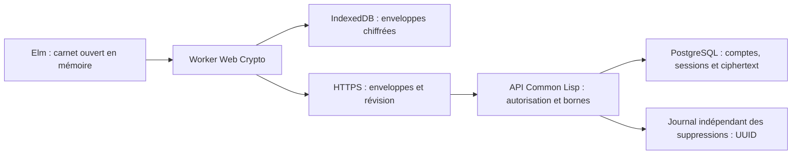

# Architecture et contrats

## Flux

Le catalogue pédagogique entier est public pour le prototype. Les étapes consultées ne changent ni l’URL ni les chemins de requêtes. L’API `/api/state` reçoit une enveloppe globale ; les pièces jointes utilisent des UUID aléatoires. Aucun titre, note, nom de fichier, préférence, statut de défi ou étape personnelle ne sert de colonne serveur. Les vues de progression sont calculées en Elm après déchiffrement. Les références aux documents internes expliquent la provenance sans les servir.

## Clés et formats

`bridge/crypto.ts` appelle Web Crypto ; aucune primitive cryptographique artisanale. AES-256-GCM, clé de données aléatoire de 32 octets, IV aléatoire de 12 octets renouvelé, tag de 128 bits. AAD UTF-8 : `mon-carnet|1|<UUID coffre>|<objet>`. L’objet vaut `journal`, `phrase`, `recovery` ou l’UUID d’une image. Les tests comportent un vecteur AES-GCM NIST et un déchiffrement indépendant Node/OpenSSL avec le même contexte.

Enveloppe v1 : `v`, `vault`, `object`, `iv`, `ct`, encodages base64 canoniques. L’enveloppe de phrase ajoute `salt` (16 octets) et `rounds` (exactement 600 000). Le trousseau contient deux enveloppes de la même clé de données : phrase et récupération. La phrase distincte est dérivée via PBKDF2-HMAC-SHA256 en Worker. Paramètres bornés avant calcul. Ce choix utilise les implémentations natives maintenues et interopérables ; il demeure moins résistant au matériel spécialisé qu’une KDF à mémoire. Le coût et l’accompagnement de la phrase doivent être évalués sur téléphones réels. Les opérations du Worker sont sérialisées, y compris le retrait des clés.

Le code de récupération du coffre est un secret aléatoire de 256 bits utilisé localement pour ouvrir son enveloppe. Le code de récupération du compte est un autre secret de 256 bits : seul son SHA-256 est conservé côté serveur. Le mot de passe de connexion est haché par scrypt N=32768, r=8, p=3, salt aléatoire 16 octets, sortie 32 octets ; format `scrypt-v1$<salt hex>$<hash hex>`. Le test indépendant de scrypt compare Ironclad à Node. La connexion n’ouvre jamais automatiquement le coffre.

Les données privées v1 sont du JSON validé profondément avant chiffrement et après déchiffrement : types, longueurs, références, identifiants uniques, étapes 0–14, statuts autorisés, trois défis actifs et deux essais par séance. Un préfixe de longueur UTF-8 permet un padding aléatoire par paliers de 4 Kio puis 16 Kio. Le document est borné à 2 Mo. Les formats inconnus sont refusés sans remplacement ; il n’existe aucun ancien format publié à migrer. Les migrations SQL sont versionnées, idempotentes et distinctes des formats cryptographiques. Une future migration privée devra se faire localement après authentification du ciphertext, jamais au serveur.

Changer la phrase réenveloppe la clé de données, sans la renouveler. Une ancienne sauvegarde reste déchiffrable avec son ancien secret. Le secret de récupération du coffre demeure valide. Perdre phrase et secret du coffre rend le contenu irrécupérable ; un nouveau coffre archive explicitement l’ancien ciphertext au lieu de le détruire. La vraie rotation de clé et la révocation cryptographique d’anciennes sauvegardes ne sont pas implémentées et nécessiteraient un protocole séparé.

## Persistance et conflits

État « En cours de chiffrement » pendant la préparation ; « Chiffré sur cet appareil » seulement après transaction IndexedDB terminée ; « Synchronisation en attente » puis « Synchronisé » après confirmation du serveur. Debounce local 650 ms, synchronisation groupée 2,2 s. Les requêtes ont un délai maximum de 15 s. Les sauvegardes sont sérialisées. Les brouillons sont scellés séparément par compte et onglet opaque ; aucun secret ni jeton n’est en localStorage. Le jeton de session est en cookie HttpOnly, SameSite=Strict, Secure en HTTPS. CSRF synchronizer token, Origin strict sur toutes les mutations, requêtes SQL paramétrées, no-store et pas de logs de corps.

`If-Match: "<révision>"` est obligatoire pour le carnet et le nouveau coffre. L’UPDATE atomique rejette une révision périmée avec 409. La copie locale reste chiffrée. Charger le serveur ou le remplacer exige une commande explicite et conserve une copie chiffrée du conflit, exportable et effaçable. Les uploads d’images et le carnet n’ont pas de transaction distribuée : un upload orphelin peut subsister après un échec ; quota et suppression bornent cette conséquence.

Images JPEG/PNG/WebP uniquement, entrée 10 Mo, dimensions vérifiées avant décodage (20 Mpx), réduction à 1600 px, réencodage JPEG par canvas (1,2 Mo), vingt pièces, quota global 64 Mo incluant les archives. Le fichier brut, ses métadonnées et son nom ne sont jamais envoyés. Le nom est dans le carnet chiffré. Un aperçu blob local est révoqué au verrouillage.

L’export chiffré contient format/version, trousseau, enveloppe et images. L’import borné vérifie la phrase, l’authenticité et le modèle avant changement, puis chiffre avec la clé du coffre actif. L’ancienne copie chiffrée est conservée localement jusqu’à suppression volontaire. L’export lisible exige une sélection et une confirmation ; il est construit localement. Le kit et les exports lisibles sont des fichiers privés sous le contrôle de la personne.

## API

| Route | Contrat |
|---|---|
| `POST /api/register`, `/api/login` | Pseudonyme, mot de passe ; création avec ciphertext et hash du code de compte |
| `POST /api/reset-auth` | Code de compte, nouveau mot de passe et nouveau code ; révoque toutes les anciennes sessions |
| `GET /api/me` | Métadonnées du compte et CSRF, aucune clé de coffre |
| `POST /api/logout` | Révocation de la session et expiration du cookie |
| `GET/PUT /api/state` | Trousseau + enveloppe ; PUT conditionnel, réponse avec révision et ETag |
| `GET /api/objects`, `GET/PUT/DELETE /api/objects/<UUID>` | Pièces opaques autorisées par compte ; aucun accès horizontal |
| `POST /api/new-vault`, `GET/DELETE /api/archives` | Préservation puis gestion explicite des anciens coffres |
| `DELETE /api/account` | CSRF, Origin, confirmation du mot de passe ; journal durable puis cascade SQL |

La démo génère son propre CryptoKey non exportable par navigateur et ne contacte pas l’API. Ce stockage sert à isoler les visiteurs ; il ne possède pas la protection par phrase du vrai coffre. Un autre utilisateur du même profil de navigateur peut rouvrir la démo. Il ne faut y écrire que des exemples fictifs.
