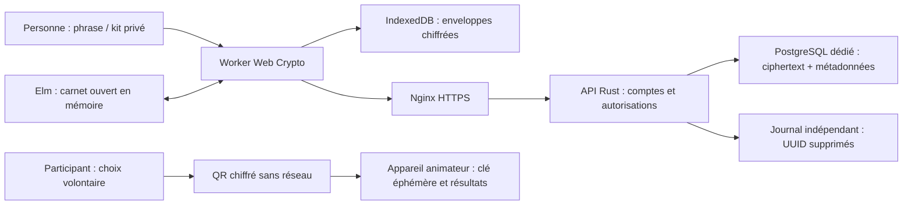

# Modèle de sécurité — ETP vie affective

## Objectif et périmètre

La personne garde la maîtrise de son carnet intime. Ni l’équipe d’animation ni
l’hébergeur ne disposent d’une clé pour le lire. Les données privées sont
chiffrées avant leur enregistrement local et avant tout envoi. Les sondages
constituent un partage volontaire séparé ; ils ne donnent jamais accès au carnet.

Ce modèle concerne le code de ce dépôt. Il ne constitue ni certification, ni audit
indépendant, ni autorisation d’usage clinique. Les essais utilisent des données fictives.

## Qui peut voir quoi ?

| Acteur | Accès |
|---|---|
| Personne, coffre ouvert | Ses textes, photos, progression et préférences sur son appareil |
| Personne, coffre verrouillé | Copies chiffrées ; phrase ou secret privé requis pour ouvrir |
| Animateur | Seulement les réponses de sondage que les participants lui transmettent ; pas leurs carnets |
| Serveur Rust / administrateur PostgreSQL | Ciphertexts, clés enveloppées, pseudonymes, hashes d’authentification, sessions et métadonnées techniques |
| Nginx / réseau | Origine, IP, horaires, volumes ; HTTPS protège le transit, pas toutes les métadonnées |
| Autre appareil | Aucun accès au coffre sans ses secrets ; un QR de réponse ne peut être ouvert que par l’appareil animateur destinataire |

## Frontières de confiance

Le cache PWA ne contient que des fichiers publics explicitement listés : application,
catalogue et supports HTML/PDF. Les réponses API ne sont jamais mises dans Cache
Storage. IndexedDB contient les enveloppes chiffrées et les métadonnées techniques
nécessaires à la synchronisation. La copie démo est une exception explicitement
fictive : sa clé locale permet de la rouvrir sans phrase.

## Coffre et récupération

AES-256-GCM, nonces aléatoires 96 bits et tag 128 bits. L’AAD lie version, coffre
et objet. La clé de données aléatoire de 256 bits est enveloppée avec une clé
PBKDF2-HMAC-SHA256 (600 000 itérations, sel 128 bits), et séparément avec un
secret de récupération aléatoire de 256 bits. Aucun secret de coffre n’entre dans
le protocole de l’API. Les paramètres et les formats sont bornés et validés.

La phrase doit être longue et distincte du mot de passe du compte. Une fuite de
base autorise des tentatives hors ligne contre une phrase faible. PBKDF2 est
interopérable avec Web Crypto mais n’offre pas la résistance mémoire d’Argon2id.
Ne pas changer de primitive sans protocole de migration et revue cryptographique.

Le mot de passe de connexion est traité côté serveur par scrypt N=32768, r=8,
p=3, avec sel 128 bits et sortie 256 bits, compatible avec l’API antérieure.
Le code de récupération du **compte** est distinct du secret de récupération du
**coffre**. L’administrateur peut rétablir l’accès technique, pas lire le carnet.
Sans phrase ni secret du coffre, les données sont irrécupérables. Changer la phrase
ne révoque pas un ancien export ou une sauvegarde déjà déchiffrable.

## Serveur et disponibilité

Rust interdit `unsafe` dans le code applicatif. Axum gère HTTP ; SQLx utilise des
requêtes paramétrées. Rust réduit les erreurs de mémoire du code applicatif ; il
ne prouve ni l’autorisation ni la sûreté de toutes les dépendances.

Chaque route privée vérifie la session et le compte propriétaire. Cookies HttpOnly,
SameSite=Strict, Secure en HTTPS ; Origin exacte et CSRF pour toute mutation.
Les sessions expirent au plus après 24 h et après 2 h d’inactivité serveur. Les
requêtes sont bornées à 4 Mo, les objets à 20, le quota à 64 Mo avec les archives.
Les écritures concurrentes verrouillent le compte et vérifient la révision ; un
conflit ne remplace pas silencieusement une copie. Deux dérivations scrypt maximum
sont exécutées simultanément, hors du moteur asynchrone.

Aucune journalisation des corps ni des accès applicatifs. Limites d’authentification
par IP directe et pseudonyme, mémoire éphémère bornée. Le proxy ne doit pas publier
ses propres logs sensibles. Nginx termine HTTPS ; PostgreSQL reste privé et utilise
un rôle dédié. Un seul processus écrit le journal des suppressions.

Le journal est synchronisé sur disque avant l’effacement SQL, conservé indépendamment
des sauvegardes et rejoué avant l’ouverture du service. Un journal absent sur base
existante, malformé ou illisible bloque le démarrage. Une sauvegarde du journal
obsolète compromet cette mesure : procédure de restauration obligatoire.

## Hors ligne et appareil partagé

L’installation préalable télécharge toutes les ressources publiques. Le carnet
est ouvert localement avec sa phrase, même si la session serveur a expiré.
L’expiration du compte distant ne rend pas illisible une copie déjà téléchargée.
Le serveur ne peut pas révoquer l’accès hors ligne d’un appareil détenant les secrets.

Les modifications sont scellées puis enregistrées dans IndexedDB avant de s’annoncer
sauvegardées. La synchronisation exige une session du même compte. Les conflits
restent explicites. Le navigateur peut supprimer son stockage : conserver une
sauvegarde chiffrée et le kit hors de l’appareil. Une fermeture brutale dans le délai
de sauvegarde peut perdre la dernière saisie. Le verrouillage enlève modèle,
aperçus et références aux clés ; l’effacement physique de la mémoire JS n’est pas garanti.

La déconnexion hors ligne verrouille localement mais ne peut pas révoquer le cookie
sur le serveur. Fermer le profil navigateur sur appareil partagé ; l’information
à l’écran rappelle la nécessité de revenir en ligne pour la révocation.

## Limite majeure : livraison du client

**Une PWA ne permet pas de garantir « sous aucun prétexte » face à un opérateur
qui contrôle activement le code livré.** Un serveur compromis pourrait distribuer
un JavaScript qui vole la phrase au prochain déverrouillage. Le service worker,
HTTPS et une CSP ne suffisent pas à empêcher cela. Un appareil infecté, une extension
malveillante, une capture d’écran ou une personne devant un coffre ouvert restent
également hors des garanties cryptographiques.

Pour exiger l’indépendance vis-à-vis de cet opérateur actif, il faut distribuer
un client installé, signé et vérifié par un canal indépendant, avec revue de mises
à jour et de la chaîne de signature. Tauri est une option compatible avec le serveur
Rust et le frontend Elm ; l’enveloppe native ne suffit pas sans cette gouvernance.
Cette version implémente la PWA et documente ce risque ; elle n’implémente pas une
chaîne de distribution native indépendante ni une transparence de clés.

## Dossier pour l’organisme évaluateur

Fournir ce modèle, les contrats et formats dans ARCHITECTURE-CRYPTO.md, le tableau
MENACES.md, les résultats exécutés, les versions verrouillées, les procédures
backup/restauration/sortie, et la documentation des sondages. Faire examiner le
protocole crypto, l’authentification, le client et la chaîne de livraison par un tiers.
Compléter avec le responsable de traitement les bases juridiques, l’AIPD, les
sous-traitants, la durée, les droits et l’éventuelle obligation HDS. Une licence
libre ou un langage ne remplace aucun de ces éléments.
